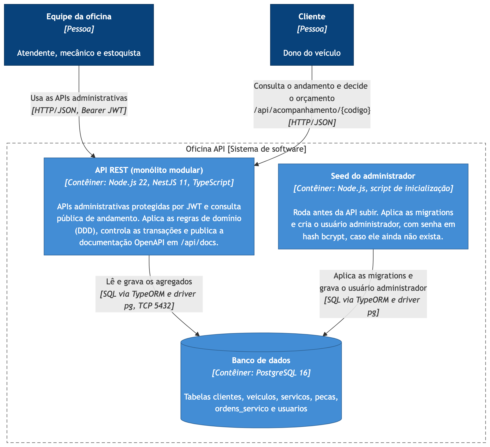

# Oficina API

Sistema Integrado de Atendimento e Execução de Serviços de uma oficina mecânica. Esta é a primeira versão (MVP) do back-end, desenvolvida para o Tech Challenge da Fase 1 do curso SOAT.

- **Curso**: SOAT - Software Architecture
- **Fase**: 1
- **Grupo**: 27
- **Integrante**: Moacyr Cabral da Silva (RM 378180) - Turma 18SOAT

## Objetivo do projeto

Substituir o controle manual da oficina (anotações e planilhas) por um sistema que organiza o atendimento, do recebimento do veículo até a entrega. O foco é a gestão de ordens de serviço, clientes e peças, com orçamento automático, controle de status, controle de estoque e acompanhamento pelo cliente.

## Descrição resumida da solução

O sistema expõe uma API REST para a operação administrativa da oficina e uma API pública para o cliente acompanhar a ordem e aprovar ou rejeitar o orçamento. O fluxo central é a Ordem de Serviço: ela é aberta com o CPF/CNPJ do cliente e a placa do veículo, passa por diagnóstico, recebe serviços e peças, gera um orçamento, aguarda a aprovação do cliente, entra em execução, é finalizada e entregue. Cada etapa é controlada por uma máquina de estados que recusa transições inválidas. A aprovação do orçamento baixa o estoque das peças na mesma transação, e operações simultâneas na mesma ordem ou na mesma peça são executadas uma de cada vez, garantindo consistência.

## Arquitetura utilizada

Monolito em camadas, no estilo Clean Architecture, com os contextos de negócio separados por módulos. Cada módulo tem quatro camadas:

- **domain**: entidades, agregados, objetos de valor, eventos e portas de repositório. Sem dependência de framework.
- **application**: casos de uso e limites de transação.
- **infrastructure**: TypeORM, autenticação JWT e adaptadores entre contextos.
- **interface**: controllers REST, DTOs validados e Swagger.



O detalhamento está em [docs/arquitetura.md](docs/arquitetura.md). Diagramas de arquitetura (exportados também em [PDF](docs/arquitetura/diagramas-arquitetura.pdf)):

- [Modelo C4](docs/arquitetura/c4.md): contexto, contêineres, componentes e implantação com docker-compose.
- [Camadas do monólito](docs/arquitetura/camadas.md): regra de dependência entre domain, application, infrastructure e interface.
- [Diagramas de sequência](docs/arquitetura/sequencias.md): autenticação, abertura da OS, aprovação com baixa de estoque, finalização e consulta pública.
- [Modelo de dados](docs/arquitetura/modelo-de-dados.md): tabelas do PostgreSQL e decisões de persistência.

## Tecnologias utilizadas

- Node.js e TypeScript
- NestJS 11
- TypeORM com PostgreSQL
- Autenticação JWT com Passport
- Validação com class-validator
- Documentação com Swagger (OpenAPI)
- Testes com Jest e Supertest
- Docker e docker-compose

## Pré-requisitos

- Docker e Docker Compose (caminho recomendado), ou
- Node.js 20 ou superior e um PostgreSQL acessível (execução sem Docker)

## Instruções para execução

### Opção 1: Docker Compose (recomendado)

Sobe a aplicação e o banco, aplica as migrations, roda o seed do usuário administrador e deixa a API pronta.

```bash
docker compose up --build
```

A API fica em `http://localhost:3000`. O Swagger fica em `http://localhost:3000/api/docs`.

### Opção 2: Execução local sem Docker

```bash
# 1. Instalar dependências
npm install

# 2. Configurar o ambiente
cp .env.example .env
# ajuste as credenciais do banco no .env, se necessário

# 3. Com um PostgreSQL rodando (pode ser via docker: docker compose up -d db)
# aplicar as migrations e criar o usuario administrador
npm run seed

# 4. Subir em modo desenvolvimento
npm run start:dev
```

## Usuários e credenciais de demonstração

O seed cria um usuário administrador. As credenciais padrão (configuráveis por variáveis de ambiente) são:

- **E-mail**: `admin@oficina.com.br`
- **Senha**: `Admin@123`

### Como autenticar

1. Chame `POST /api/auth/login` com o e-mail e a senha acima.
2. Use o `accessToken` retornado no cabeçalho `Authorization: Bearer <token>` nas rotas administrativas.
3. No Swagger, use o botão **Authorize** e cole o token.

Exemplo de tour rápido pela API:

```bash
# login
TOKEN=$(curl -s -X POST http://localhost:3000/api/auth/login \
  -H 'Content-Type: application/json' \
  -d '{"email":"admin@oficina.com.br","senha":"Admin@123"}' | jq -r .accessToken)

# criar cliente (CPF valido)
CLIENTE_ID=$(curl -s -X POST http://localhost:3000/api/clientes -H "Authorization: Bearer $TOKEN" \
  -H 'Content-Type: application/json' \
  -d '{"nome":"Maria Oliveira","documento":"529.982.247-25","email":"maria@email.com","telefone":"11988887777"}' | jq -r .id)

# cadastrar o veiculo do cliente
curl -s -X POST http://localhost:3000/api/veiculos -H "Authorization: Bearer $TOKEN" \
  -H 'Content-Type: application/json' \
  -d "{\"placa\":\"ABC1D23\",\"marca\":\"Fiat\",\"modelo\":\"Uno\",\"ano\":2020,\"clienteId\":\"$CLIENTE_ID\"}"

# abrir a ordem de servico pelo CPF do cliente e pela placa do veiculo
curl -s -X POST http://localhost:3000/api/ordens-servico -H "Authorization: Bearer $TOKEN" \
  -H 'Content-Type: application/json' \
  -d '{"documento":"529.982.247-25","placa":"ABC1D23"}'
```

Depois que o orçamento é enviado, o próprio cliente aprova ou rejeita pela API pública, sem token, informando o código da OS e o seu documento: `POST /api/acompanhamento/{codigo}/orcamento/aprovar` com `{"documento":"529.982.247-25"}`.

## Instruções para execução dos testes

```bash
# testes unitarios e de componente
npm test

# testes com relatorio de cobertura (dominios criticos)
npm run test:cov

# testes de integracao (e2e) dos fluxos principais, em banco em memoria (sql.js)
npm run test:e2e

# os mesmos testes no PostgreSQL real, com o schema criado pelas migrations,
# mais os testes de concorrencia e de migrations (requer o banco no ar)
docker compose up -d db
npm run test:e2e:pg
```

A cobertura mínima exigida é de 80% nos domínios críticos. A suíte entrega cerca de 99% de linhas e 85% de ramos nas camadas de domínio e nos fluxos do núcleo. O escopo da medição está documentado em `jest.config.js`.

O `test:e2e:pg` usa um banco separado (`oficina_teste`, criado automaticamente e apagado a cada execução) e as variáveis `DB_HOST`, `DB_PORT`, `DB_USERNAME` e `DB_PASSWORD`, com os mesmos padrões do `docker-compose.yml`. Os testes de concorrência travam uma linha no banco, disparam requisições simultâneas e verificam que nenhuma atualização se perde.

## Acesso ao Swagger

Com a aplicação no ar, a documentação interativa da API fica em:

```
http://localhost:3000/api/docs
```

## Decisão e justificativa do banco de dados

O banco escolhido foi o **PostgreSQL**, por três motivos principais: transações ACID (necessárias para aprovar o orçamento e baixar o estoque de forma atômica), bloqueio de linha (`SELECT ... FOR UPDATE`) para que operações simultâneas na mesma ordem ou na mesma peça não se sobrescrevam, e maturidade com custo zero. O schema é versionado em migrations (`src/database/migrations`), aplicadas automaticamente na subida. A justificativa completa, com as alternativas consideradas, está em [docs/arquitetura.md](docs/arquitetura.md).

## Estrutura dos principais diretórios

```
oficina-api/
├── src/
│   ├── main.ts                      # bootstrap, Swagger, pipes e filtros globais
│   ├── app.module.ts                # composicao dos modulos
│   ├── shared/                      # nucleo compartilhado
│   │   ├── domain/                  # bases de dominio, Dinheiro, excecoes
│   │   ├── application/             # porta da Unidade de Trabalho
│   │   └── infrastructure/          # config, banco, transacoes, filtro HTTP
│   ├── modules/
│   │   ├── auth/                    # autenticacao JWT
│   │   ├── clientes/                # cadastro de clientes (CPF/CNPJ)
│   │   ├── veiculos/                # cadastro de veiculos (placa)
│   │   ├── servicos/                # catalogo de servicos
│   │   ├── pecas/                   # pecas e controle de estoque
│   │   └── ordens-servico/          # nucleo: OS, orcamento, status, tempo medio
│   │       ├── domain/              # agregado, VOs, maquina de estados, eventos
│   │       ├── application/         # casos de uso e portas
│   │       ├── infrastructure/      # persistencia e adaptadores entre contextos
│   │       └── interface/           # controllers administrativo e publico
│   └── database/
│       ├── migrations/              # schema versionado do PostgreSQL
│       └── seeds/                   # seed do usuario administrador
├── test/                            # testes de integracao (e2e), concorrencia e migrations
├── docs/
│   ├── arquitetura.md               # visao geral, banco de dados e decisoes
│   ├── arquitetura/                 # C4, camadas, sequencias e modelo de dados
│   ├── ddd/                         # Event Storming, diagramas e linguagem ubiqua
│   └── security/                    # analise de vulnerabilidades
├── Dockerfile
└── docker-compose.yml
```

Cada módulo segue a mesma divisão em domain, application, infrastructure e interface.

## Documentação DDD

- Documentação versionada no repositório: [docs/ddd/](docs/ddd/)
  - [Event Storming](docs/ddd/event-storming.md) ([PDF](docs/ddd/event-storming.pdf))
  - [Diagramas](docs/ddd/diagramas.md): mapa de contextos, modelo de domínio, agregado e máquina de estados ([PDF](docs/ddd/diagramas.pdf))
  - [Linguagem Ubíqua](docs/ddd/linguagem-ubiqua.md)
  - [Glossário](docs/ddd/glossario.md)
  - [Relação entre documentação e código](docs/ddd/ddd-para-codigo.md)
- Documentação no Miro (link externo): «informe o link do Miro»

## Vídeo da entrega

- «informe o link do vídeo no YouTube»

## Análise de vulnerabilidades

O resultado do `npm audit` e a avaliação de risco estão em [docs/security/analise-vulnerabilidades.md](docs/security/analise-vulnerabilidades.md).

## Visão geral dos endpoints

| Método | Rota | Protegido | Descrição |
|--------|------|-----------|-----------|
| POST | `/api/auth/login` | Não | Autentica e retorna o token JWT |
| GET/POST/PUT/DELETE | `/api/clientes` | Sim | CRUD de clientes |
| GET/POST/PUT/DELETE | `/api/veiculos` | Sim | CRUD de veículos |
| GET/POST/PUT/DELETE | `/api/servicos` | Sim | CRUD de serviços |
| GET/POST/PUT/DELETE | `/api/pecas` | Sim | CRUD de peças |
| POST | `/api/pecas/:id/estoque/repor` | Sim | Reposição de estoque |
| POST | `/api/ordens-servico` | Sim | Abre uma ordem pelo CPF/CNPJ do cliente e pela placa do veículo |
| GET | `/api/ordens-servico` | Sim | Lista ordens (filtro por status) |
| GET | `/api/ordens-servico/:id` | Sim | Detalha uma ordem |
| GET | `/api/ordens-servico/metricas/tempo-medio` | Sim | Tempo médio de execução |
| POST | `/api/ordens-servico/:id/diagnostico` | Sim | Inicia o diagnóstico |
| POST | `/api/ordens-servico/:id/itens-servico` | Sim | Inclui um serviço |
| POST | `/api/ordens-servico/:id/itens-peca` | Sim | Inclui uma peça |
| POST | `/api/ordens-servico/:id/orcamento/enviar` | Sim | Gera e envia o orçamento |
| POST | `/api/ordens-servico/:id/orcamento/aprovar` | Sim | Registra a aprovação informada pelo cliente e inicia a execução |
| POST | `/api/ordens-servico/:id/orcamento/rejeitar` | Sim | Registra a rejeição informada pelo cliente |
| POST | `/api/ordens-servico/:id/finalizar` | Sim | Finaliza a ordem |
| POST | `/api/ordens-servico/:id/entregar` | Sim | Registra a entrega |
| GET | `/api/acompanhamento/:codigo?documento=` | Não | Consulta pública do andamento |
| POST | `/api/acompanhamento/:codigo/orcamento/aprovar` | Não | O cliente aprova o orçamento (corpo: `documento`) |
| POST | `/api/acompanhamento/:codigo/orcamento/rejeitar` | Não | O cliente rejeita o orçamento (corpo: `documento` e `motivo` opcional) |

Nas rotas públicas, o código da OS e o documento do cliente funcionam juntos como verificação: ordem inexistente e documento incorreto recebem a mesma resposta 404. Remover um cliente ou veículo que já tem ordens de serviço, ou um cliente que ainda tem veículos, retorna 409, preservando o histórico.

## Licença

Uso acadêmico, no contexto do Tech Challenge SOAT.
