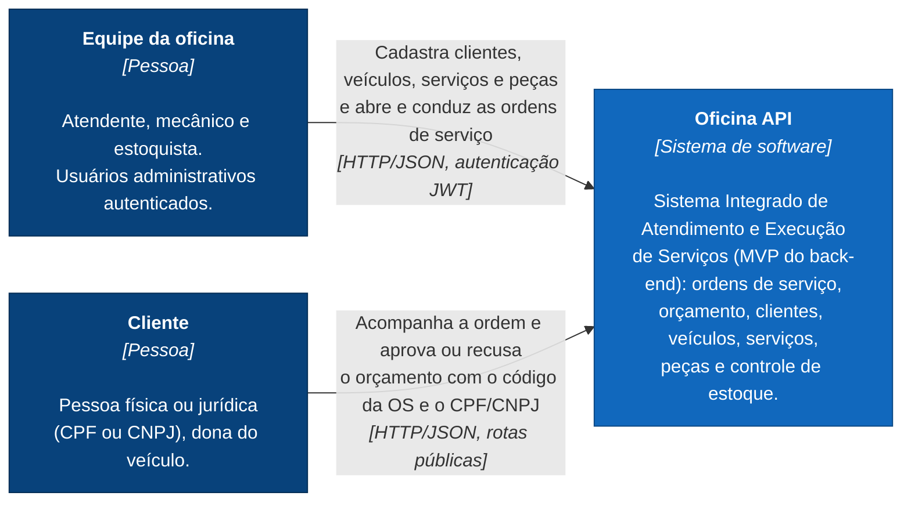
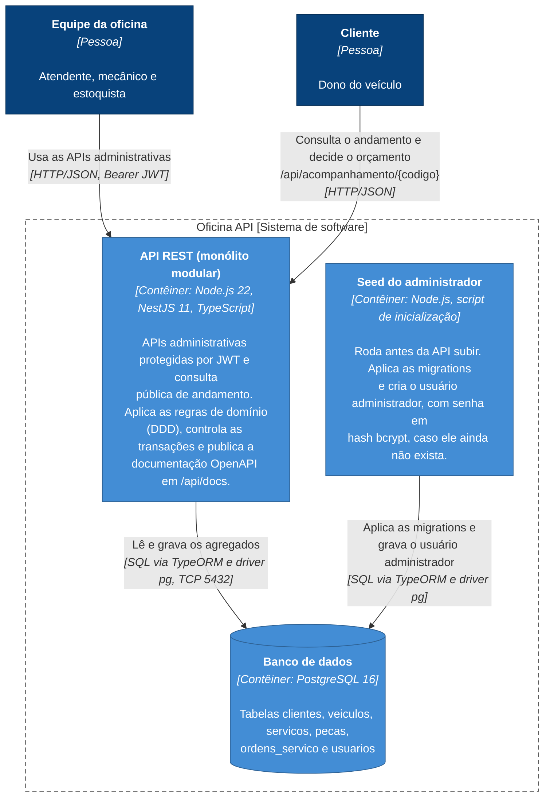
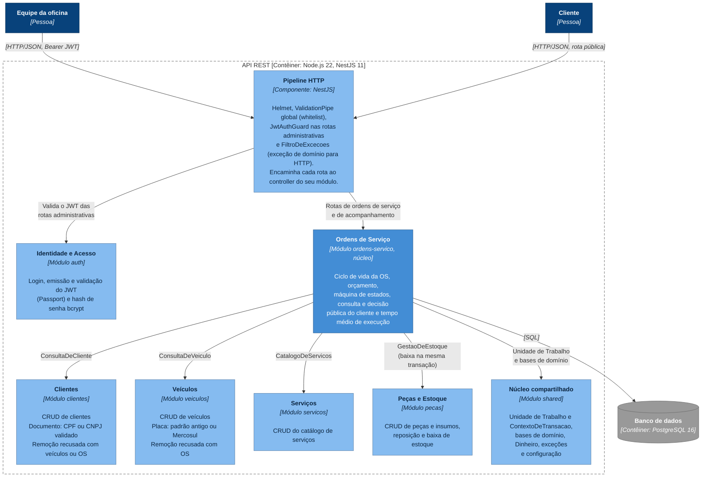
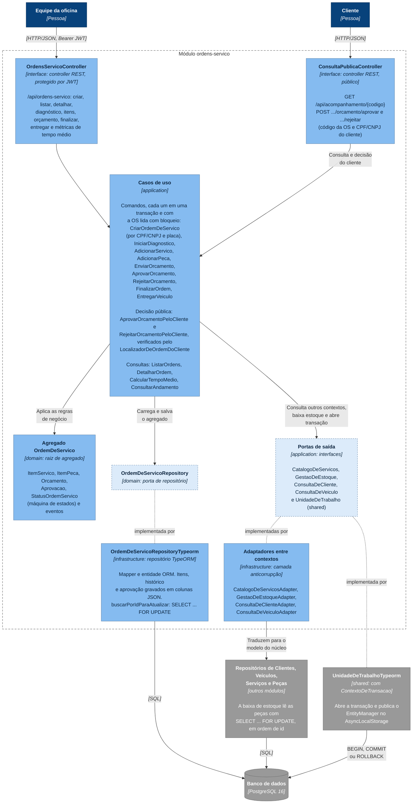
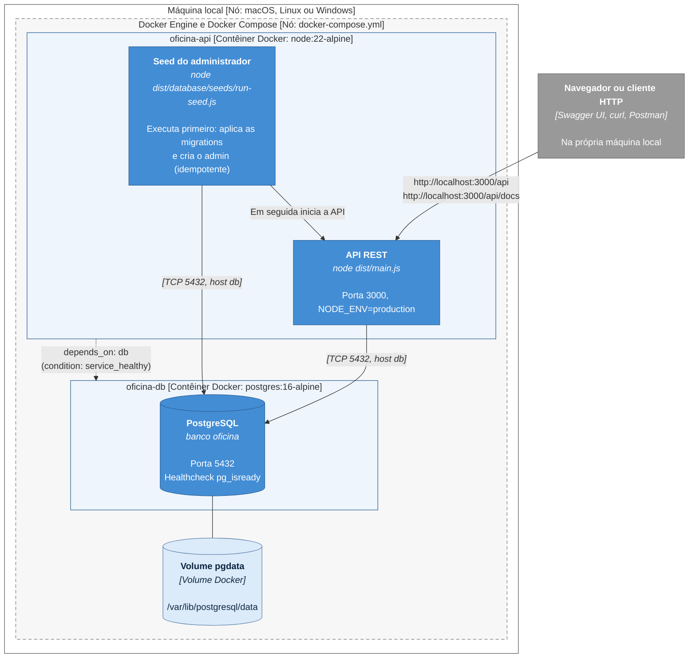

# Modelo C4

Este documento descreve a arquitetura da Oficina API com o [modelo C4](https://c4model.com/), do nível mais amplo (contexto) ao mais detalhado (código). Os diagramas usam Mermaid e são renderizados diretamente no GitHub. As versões exportadas estão em [imagens/](imagens/) e consolidadas em [diagramas-arquitetura.pdf](diagramas-arquitetura.pdf).

## Legenda

| Cor | Elemento C4 |
|-----|-------------|
| Azul escuro | Pessoa (ator humano) |
| Azul médio | Sistema de software em foco |
| Azul | Contêiner (aplicação ou banco que roda de forma independente) |
| Azul claro | Componente (agrupamento de código dentro de um contêiner) |
| Cinza | Elemento externo ao escopo do diagrama |
| Borda tracejada | Fronteira (sistema, contêiner ou módulo) |

Cada caixa traz o nome, o tipo do elemento entre colchetes e uma descrição curta. Cada seta traz a intenção da interação e, entre colchetes, a tecnologia usada.

## Nível 1: Diagrama de Contexto do Sistema

Mostra quem usa o sistema e para quê. No MVP não há integração com sistemas externos (e-mail, SMS ou pagamento): toda a interação acontece pela API REST.

<!-- diagrama: c4-1-contexto -->

## Nível 2: Diagrama de Contêineres

Abre o sistema e mostra as unidades que rodam de forma independente. A aplicação é um monólito: um único processo Node.js concentra todas as APIs. O seed é um script separado, executado antes da API subir, que aplica as migrations pendentes e garante a existência do usuário administrador.

<!-- diagrama: c4-2-conteineres -->

## Nível 3: Diagrama de Componentes

### Visão por módulos (bounded contexts)

Abre o contêiner da API. Cada módulo NestJS corresponde a um contexto de negócio e é dividido internamente nas camadas domain, application, infrastructure e interface (ver [camadas.md](camadas.md)). O módulo de Ordens de Serviço é o núcleo e consome os demais contextos apenas por portas.

O pipeline HTTP encaminha cada rota ao controller do seu módulo (`/api/auth`, `/api/clientes`, `/api/veiculos`, `/api/servicos`, `/api/pecas`, `/api/ordens-servico` e `/api/acompanhamento`). Todos os módulos usam o núcleo compartilhado e persistem no PostgreSQL pelos seus próprios repositórios TypeORM. Para manter o diagrama legível, essas setas repetitivas aparecem apenas a partir do núcleo.

<!-- diagrama: c4-3a-componentes-modulos -->

### Núcleo: módulo Ordens de Serviço

Detalha o módulo central em portas e adaptadores. Os casos de uso dependem apenas de interfaces (portas). As implementações concretas ficam na infraestrutura: o repositório TypeORM do agregado e os adaptadores que traduzem os modelos dos outros contextos para o modelo do núcleo, funcionando como camada anticorrupção.

As linhas pontilhadas ligam cada porta (interface) à implementação concreta na infraestrutura. Os repositórios obtêm o `EntityManager` da transação corrente a partir do `ContextoDeTransacao`, por isso participam automaticamente da transação aberta pelo caso de uso.

<!-- diagrama: c4-3b-componentes-ordens-servico -->

## Nível 4: Código

O nível de código do núcleo está documentado nos diagramas de DDD, que refletem as classes do domínio:

- [Modelo de domínio](../ddd/diagramas.md#modelo-de-domínio): agregados, entidades, objetos de valor e referências por identidade.
- [Agregado Ordem de Serviço](../ddd/diagramas.md#diagrama-do-agregado-ordem-de-serviço): estrutura interna da raiz e dos itens.
- [Máquina de estados](../ddd/diagramas.md#máquina-de-estados-da-ordem-de-serviço): transições permitidas da OS.

## Diagrama de Implantação

Mostra como os contêineres são executados no ambiente local definido pelo `docker-compose.yml`. A imagem da API é construída em dois estágios (`Dockerfile`): o primeiro compila o TypeScript e o segundo leva apenas o JavaScript compilado e as dependências de produção.

<!-- diagrama: c4-implantacao -->

Variáveis de ambiente relevantes, definidas no `docker-compose.yml`: `DB_HOST=db`, `DB_MIGRATIONS_RUN=true` (as migrations pendentes são aplicadas na subida), `DB_SYNCHRONIZE=false`, `JWT_SECRET`, `JWT_EXPIRES_IN`, `ADMIN_EMAIL` e `ADMIN_PASSWORD`. Com `NODE_ENV=production`, a aplicação recusa subir sem `JWT_SECRET` e `ADMIN_PASSWORD` definidos.
