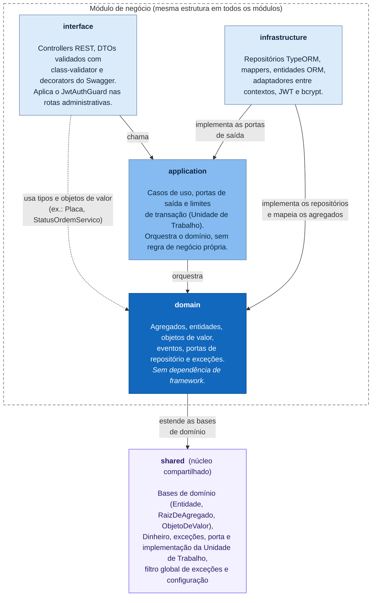

# Organização do monólito em camadas

O monólito é dividido em módulos por contexto de negócio (`auth`, `clientes`, `veiculos`, `servicos`, `pecas` e `ordens-servico`), mais o núcleo compartilhado (`shared`). Dentro de cada módulo, o código segue as mesmas quatro camadas, no estilo Clean Architecture (portas e adaptadores).

## Regra de dependência

As dependências apontam sempre para dentro, em direção ao domínio. O domínio não importa NestJS, TypeORM nem qualquer outra biblioteca de infraestrutura. A infraestrutura depende das camadas internas porque implementa as portas que elas declaram, e não o contrário.

<!-- diagrama: camadas-regra-de-dependencia -->

## Correspondência com as pastas

| Camada | Pasta (exemplo do núcleo) | Exemplos |
|--------|---------------------------|----------|
| interface | `src/modules/ordens-servico/interface/` | `ordens-servico.controller.ts`, `consulta-publica.controller.ts`, `dto/` |
| application | `src/modules/ordens-servico/application/` | `aprovar-orcamento.use-case.ts`, `ports/gestao-de-estoque.ts` |
| domain | `src/modules/ordens-servico/domain/` | `ordem-de-servico.ts`, `status-ordem-servico.ts`, `orcamento.ts` |
| infrastructure | `src/modules/ordens-servico/infrastructure/` | `ordem-de-servico.repository.typeorm.ts`, `gestao-de-estoque.adapter.ts` |
| shared | `src/shared/` | `domain/dinheiro.ts`, `infrastructure/database/unidade-de-trabalho.typeorm.ts` |

## Como uma requisição atravessa as camadas

1. O `ValidationPipe` global valida o DTO. Campos inesperados são rejeitados (`whitelist` e `forbidNonWhitelisted`).
2. Nas rotas administrativas, o `JwtAuthGuard` exige um token JWT válido.
3. O controller chama o caso de uso, que abre a transação pela Unidade de Trabalho quando altera estado.
4. O caso de uso carrega o agregado pelo repositório (nos comandos, com bloqueio de linha) e delega a regra de negócio ao domínio, por exemplo a transição de status.
5. Exceções de domínio (`ErroDeValidacao`, `RecursoNaoEncontrado`, `ConflitoDeRecurso`, `RegraDeNegocioViolada`, `FalhaDeAutenticacao`) são traduzidas pelo `FiltroDeExcecoes` para 400, 404, 409, 422 e 401.
