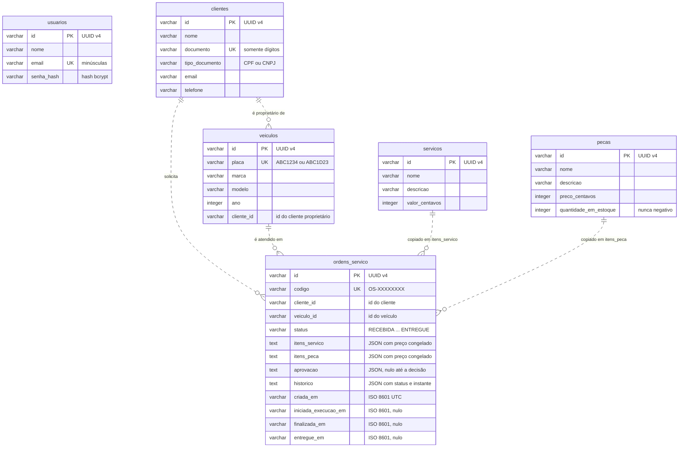

# Modelo de dados

O banco é o PostgreSQL 16, acessado pelo TypeORM. O schema é derivado das entidades ORM (`*.orm-entity.ts`) de cada módulo. A justificativa da escolha do banco está em [../arquitetura.md](../arquitetura.md#decisão-e-justificativa-do-banco-de-dados).

## Diagrama entidade-relacionamento

<!-- diagrama: modelo-de-dados -->

## Decisões de persistência

- **Uma tabela por agregado.** A Ordem de Serviço é gravada como uma unidade: itens de serviço, itens de peça, aprovação e histórico de status ficam em colunas JSON (`simple-json`, armazenadas como texto) da própria linha. Esses dados só fazem sentido dentro do agregado e nunca são consultados isoladamente, então a gravação de uma linha preserva o limite do agregado e simplifica a consistência.
- **Referência entre agregados por identificador.** Seguindo a regra de DDD de que agregados se referenciam por identidade, `veiculos.cliente_id`, `ordens_servico.cliente_id` e `ordens_servico.veiculo_id` guardam o id do outro agregado, sem chave estrangeira física (as linhas pontilhadas do diagrama representam essas referências lógicas). As regras de vínculo ficam nos casos de uso. Na criação, o veículo exige um cliente existente, e a OS exige cliente e veículo existentes, com o veículo pertencente ao cliente. Na remoção, um cliente com veículos ou ordens e um veículo com ordens não podem ser removidos (HTTP 409), preservando o histórico.
- **Preço congelado nos itens.** Cada item da OS guarda a descrição e o valor unitário do serviço ou da peça no momento da inclusão. Alterações posteriores no catálogo não mudam orçamentos já montados.
- **Valores monetários em centavos.** Preços e valores são inteiros em centavos, evitando erros de arredondamento de ponto flutuante. O objeto de valor `Dinheiro` faz a conversão para reais na saída da API.
- **Unicidade garantida também no banco.** Índices únicos em `clientes.documento`, `veiculos.placa`, `usuarios.email` e `ordens_servico.codigo` complementam as verificações feitas nos casos de uso.
- **Datas em texto ISO 8601 (UTC).** As datas da OS são gravadas como texto ISO, o que mantém o mesmo mapeamento no PostgreSQL e no banco em memória (sql.js) usado nos testes de integração. O tempo médio de execução é calculado a partir dos agregados carregados.
- **Bloqueio de linha nas alterações.** Comandos sobre uma OS e movimentações de estoque leem a linha com `SELECT ... FOR UPDATE`, então alterações simultâneas da mesma ordem ou peça acontecem uma de cada vez.
- **Schema versionado em migrations.** O schema é criado pela migration `src/database/migrations/1793037380673-EsquemaInicial.ts`, gerada pelo TypeORM a partir das entidades e aplicada na subida (`DB_MIGRATIONS_RUN=true`). A tabela `migrations`, mantida pelo TypeORM, registra o que já foi aplicado. A sincronização automática (`DB_SYNCHRONIZE`) fica desligada. Novas mudanças de schema são geradas com `npm run migration:generate -- src/database/migrations/NomeDaMudanca`.

## Conteúdo das colunas JSON da Ordem de Serviço

| Coluna | Estrutura |
|--------|-----------|
| `itens_servico` | lista de `{ itemId, servicoId, descricao, valorCentavos, quantidade }` |
| `itens_peca` | lista de `{ itemId, pecaId, descricao, valorCentavos, quantidade }` |
| `aprovacao` | `{ decisao: APROVADO ou REJEITADO, registradoEm, motivo? }` ou nulo |
| `historico` | lista de `{ status, em }`, um registro por transição de status |
