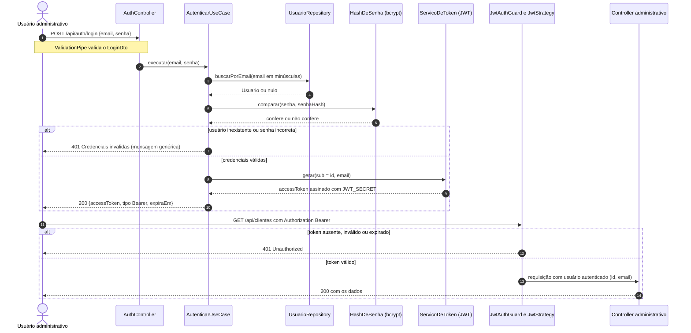
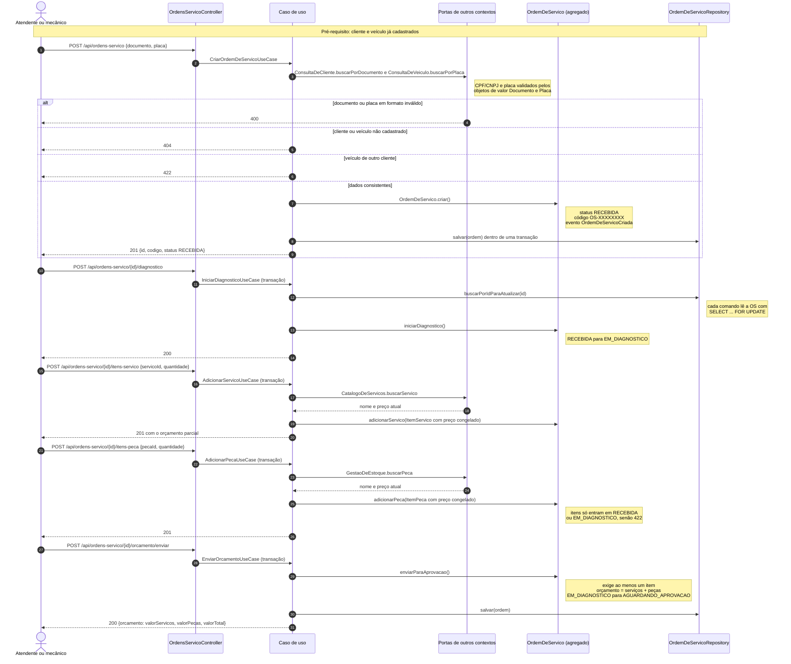
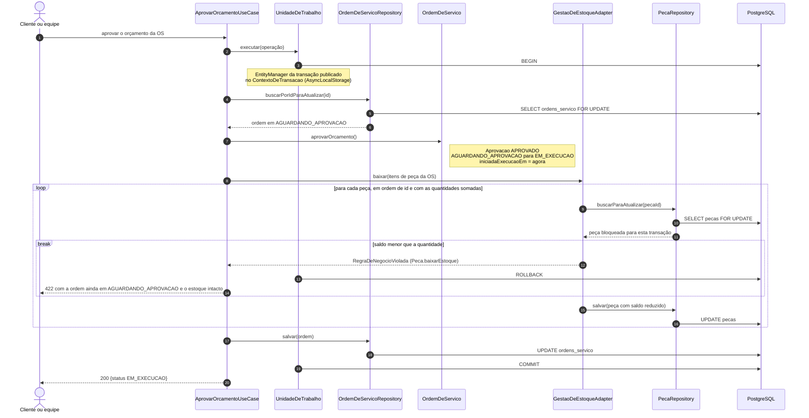
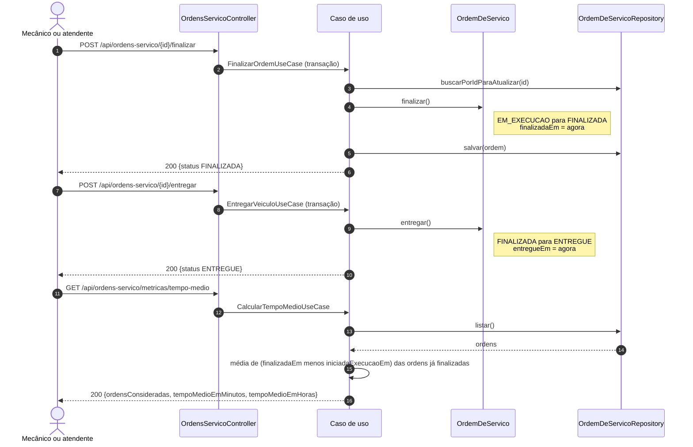
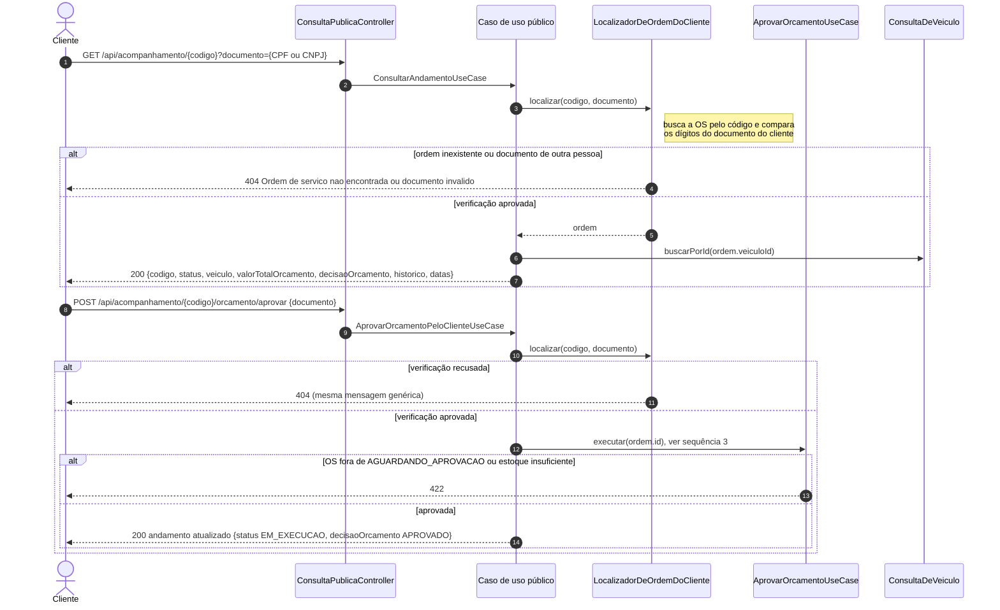

# Diagramas de sequência dos fluxos principais

Estes diagramas mostram, passo a passo, como os componentes colaboram nos fluxos exigidos pelo desafio. Eles complementam o [modelo C4](c4.md) com a visão dinâmica. Os nomes correspondem às classes do código em `src/modules/`.

## 1. Autenticação JWT e acesso a uma rota administrativa

O login devolve um token JWT. As rotas administrativas exigem esse token no cabeçalho `Authorization`. Credencial inválida sempre recebe a mesma mensagem genérica, para não revelar se o e-mail existe.

<!-- diagrama: seq-1-autenticacao -->

## 2. Abertura da OS, inclusão de itens e envio do orçamento

Fluxo de criação da Ordem de Serviço. O cliente é identificado pelo CPF/CNPJ e o veículo pela placa. Cada item guarda o preço do catálogo no momento da inclusão. O orçamento é calculado pelo agregado, nunca digitado. O estoque ainda não é baixado nesta etapa.

<!-- diagrama: seq-2-abertura-orcamento -->

## 3. Aprovação do orçamento com baixa de estoque na mesma transação

Fluxo transacional crítico. A mudança de status da OS e a baixa de estoque das peças acontecem juntas ou não acontecem. A OS e as peças são lidas com bloqueio de linha: aprovações simultâneas da mesma OS rodam uma de cada vez, e só a primeira baixa o estoque. As peças são bloqueadas em ordem de identificador, o que evita deadlock entre aprovações com peças em comum. A aprovação pode vir do próprio cliente, pela rota pública (sequência 5), ou da equipe, pela rota administrativa.

<!-- diagrama: seq-3-aprovacao-transacao -->

A rejeição segue o mesmo padrão transacional, com a OS lida com bloqueio. Ela registra a decisão com o motivo opcional e devolve a OS para `EM_DIAGNOSTICO`, sem mexer no estoque.

## 4. Finalização, entrega e tempo médio de execução

A finalização registra o instante usado no cálculo do tempo médio. Qualquer transição fora da máquina de estados é recusada pelo agregado com 422.

<!-- diagrama: seq-4-finalizacao-tempo-medio -->

## 5. Consulta e decisão do cliente pela API pública

Rotas sem JWT. O código da OS e o documento do cliente funcionam juntos como verificação, feita pelo `LocalizadorDeOrdemDoCliente`. Ordem inexistente e documento incorreto recebem a mesma resposta, o que impede descobrir códigos de ordens válidos por tentativa. Depois da verificação, a decisão usa os mesmos casos de uso transacionais da equipe.

<!-- diagrama: seq-5-consulta-publica -->

A rejeição pelo cliente (`POST /api/acompanhamento/{codigo}/orcamento/rejeitar`, com `documento` e `motivo` opcional) faz a mesma verificação e usa o `RejeitarOrcamentoUseCase`.
