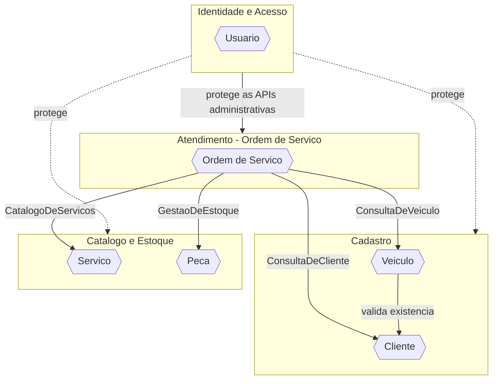
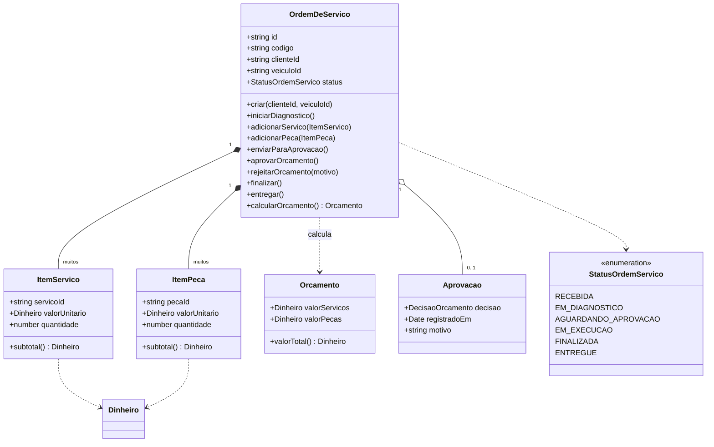
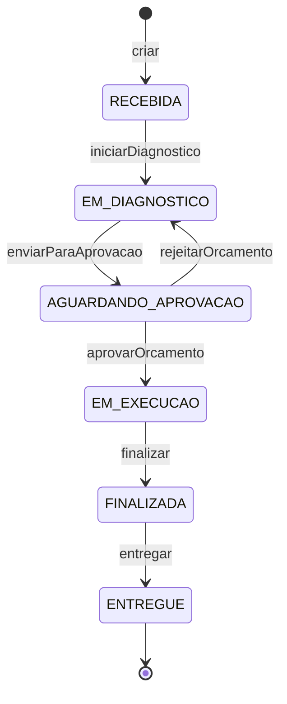

# Diagramas

Versão exportada em [diagramas.pdf](diagramas.pdf). Imagens individuais em [imagens/](imagens/).

## Mapa de Contextos

Relação entre os bounded contexts. O contexto de Atendimento (Ordem de Serviço) é o núcleo e consome os demais por meio de portas (interfaces) definidas na sua camada de aplicação, implementadas por adaptadores que delegam aos repositórios dos outros contextos.

As portas do núcleo estão em `modules/ordens-servico/application/ports/` e os adaptadores em `modules/ordens-servico/infrastructure/*.adapter.ts`.

## Diagrama do agregado Ordem de Serviço

A raiz do agregado é `OrdemDeServico`. `ItemServico` e `ItemPeca` são entidades internas, acessadas apenas pela raiz. `Orcamento`, `Aprovacao`, `StatusOrdemServico` e `Dinheiro` são objetos de valor.

## Máquina de estados da Ordem de Serviço

Qualquer transição fora dessas setas é recusada pelo agregado com um erro de regra de negócio. A implementação está em `status-ordem-servico.ts` (tabela de transições) e no método privado `transicionarPara` de `ordem-de-servico.ts`.
