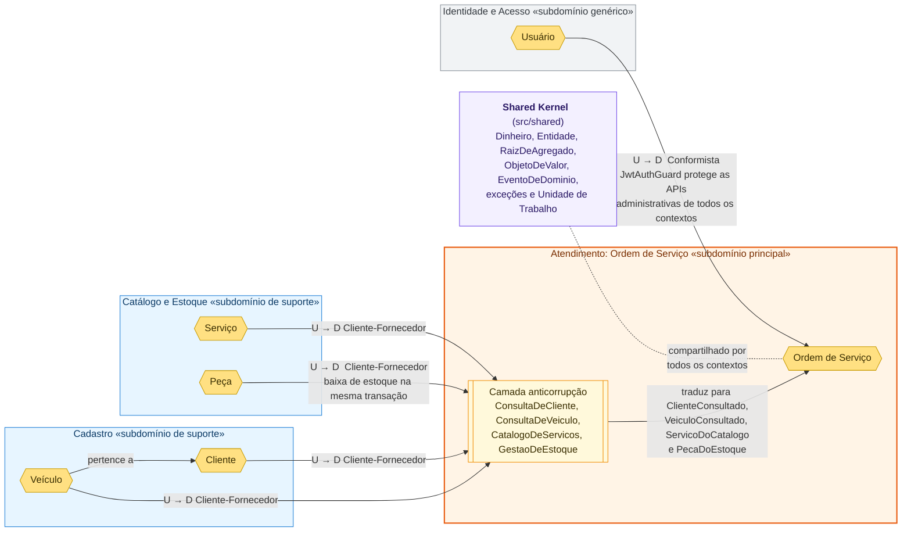
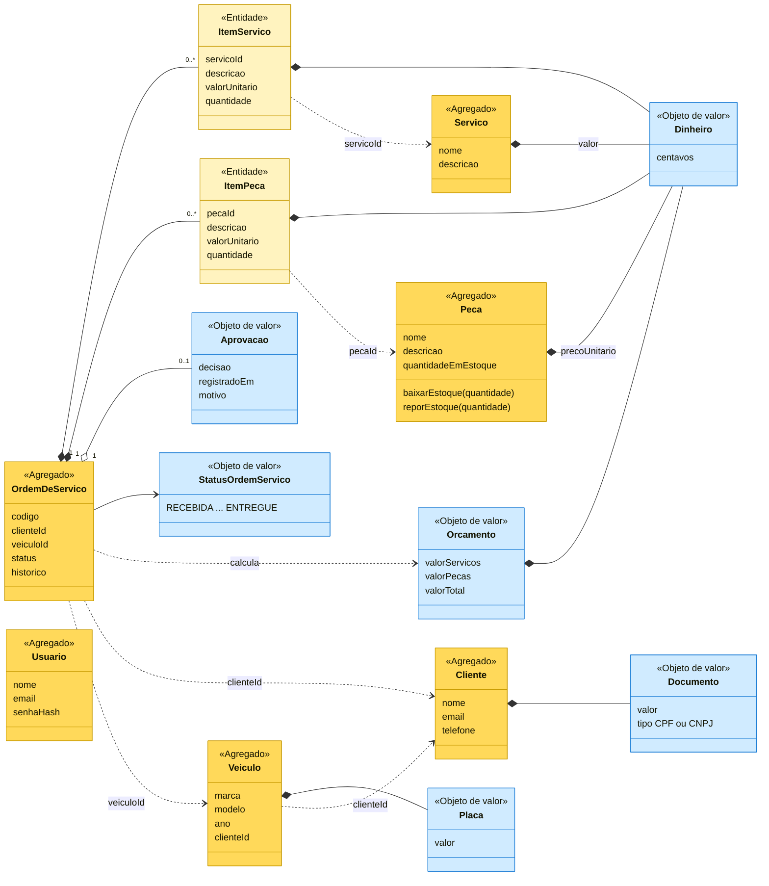
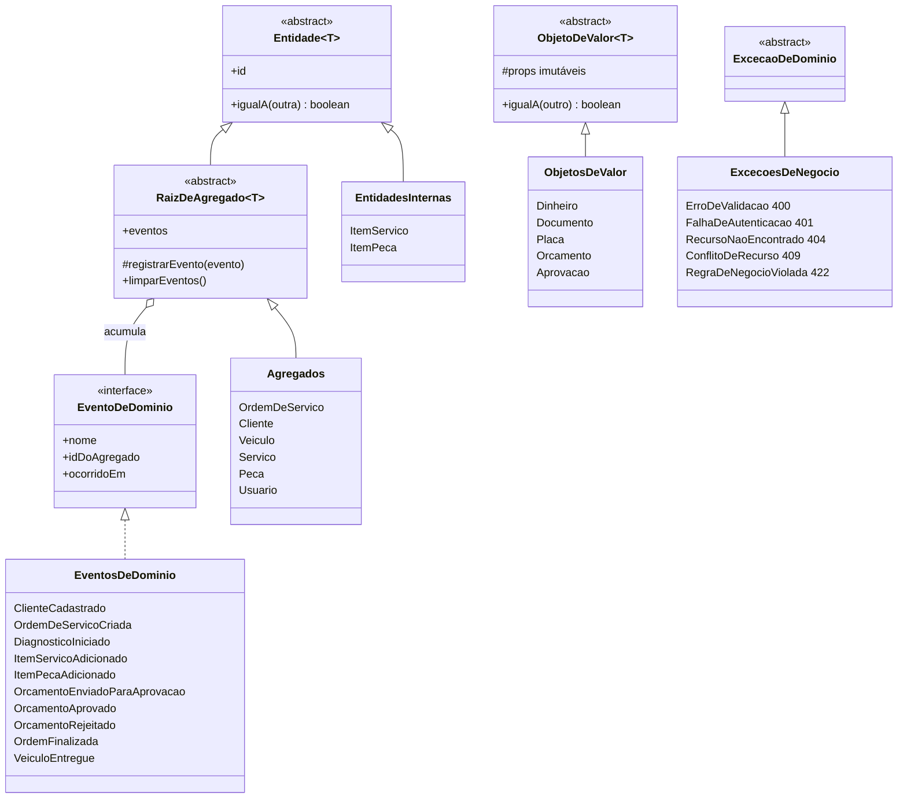
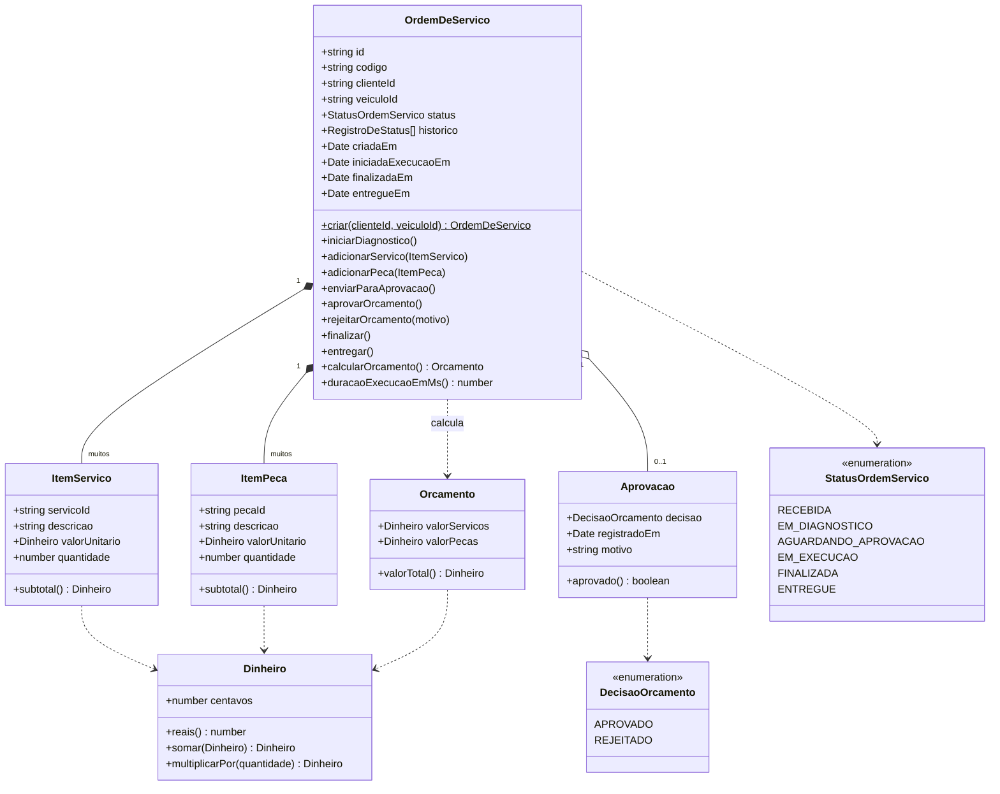
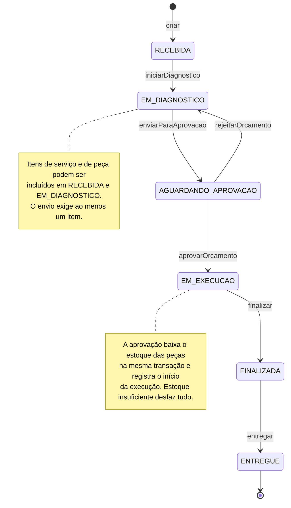

# Diagramas

Versão exportada em [diagramas.pdf](diagramas.pdf). Imagens individuais em [imagens/](imagens/). A visão de arquitetura (modelo C4, implantação, sequências e modelo de dados) está em [../arquitetura/](../arquitetura/c4.md).

## Mapa de Contextos

Relação entre os bounded contexts e a classificação dos subdomínios. O contexto de Atendimento (Ordem de Serviço) é o núcleo do negócio e consome os demais por meio de portas (interfaces) definidas na sua camada de aplicação. Os adaptadores que implementam essas portas traduzem os modelos dos outros contextos para o modelo do núcleo, funcionando como camada anticorrupção.

<!-- diagrama: diagrama-mapa-contextos -->

Leitura dos padrões (U = upstream, quem fornece; D = downstream, quem consome):

| Relação | Padrão | Onde está no código |
|---------|--------|---------------------|
| Cadastro → Atendimento | Cliente-Fornecedor, com camada anticorrupção no downstream | `ordens-servico/application/ports/consulta-de-cliente.ts`, `consulta-de-veiculo.ts` e os adaptadores em `ordens-servico/infrastructure/` |
| Catálogo e Estoque → Atendimento | Cliente-Fornecedor, com camada anticorrupção no downstream | `ports/catalogo-de-servicos.ts`, `ports/gestao-de-estoque.ts`, `gestao-de-estoque.adapter.ts` |
| Identidade e Acesso → demais contextos | Conformista: os controllers usam o guard de autenticação como ele é | `auth/infrastructure/jwt-auth.guard.ts` |
| Todos os contextos | Shared Kernel: bases de domínio e transação compartilhadas | `src/shared/` |

Classificação dos subdomínios:

- **Principal (core)**: Atendimento. É o que diferencia a oficina: ciclo de vida da OS, orçamento, aprovação e acompanhamento.
- **Suporte**: Cadastro (clientes e veículos) e Catálogo e Estoque (serviços e peças). Necessários ao núcleo, mas sem regra de negócio diferenciadora.
- **Genérico**: Identidade e Acesso. Problema comum a qualquer sistema, resolvido com JWT e bcrypt.

## Modelo de domínio

Agregados, entidades e objetos de valor de todos os contextos. Agregados diferentes se referenciam apenas pelo identificador (linhas pontilhadas), nunca por referência direta de objeto. Os itens da OS guardam uma cópia do preço no momento da inclusão.

<!-- diagrama: diagrama-modelo-dominio -->

Cores: amarelo para agregados, amarelo claro para entidades internas e azul claro para objetos de valor.

## Blocos táticos do núcleo compartilhado

Classes base de DDD em `src/shared/domain/` e como os elementos do domínio as estendem. As exceções de domínio não conhecem HTTP: o filtro global as traduz para o código de status indicado.

<!-- diagrama: diagrama-blocos-taticos -->

## Diagrama do agregado Ordem de Serviço

<!-- diagrama: diagrama-agregado-os -->

A raiz do agregado é `OrdemDeServico`. `ItemServico` e `ItemPeca` são entidades internas, acessadas apenas pela raiz. `Orcamento`, `Aprovacao`, `StatusOrdemServico` e `Dinheiro` são objetos de valor. A raiz registra um evento de domínio a cada operação (ver [event-storming.md](event-storming.md)).

## Máquina de estados da Ordem de Serviço

<!-- diagrama: diagrama-maquina-estados -->

Qualquer transição fora dessas setas é recusada pelo agregado com um erro de regra de negócio (HTTP 422). A implementação está em `status-ordem-servico.ts` (tabela de transições) e no método privado `transicionarPara` de `ordem-de-servico.ts`.
