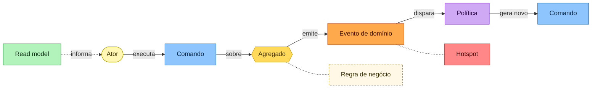
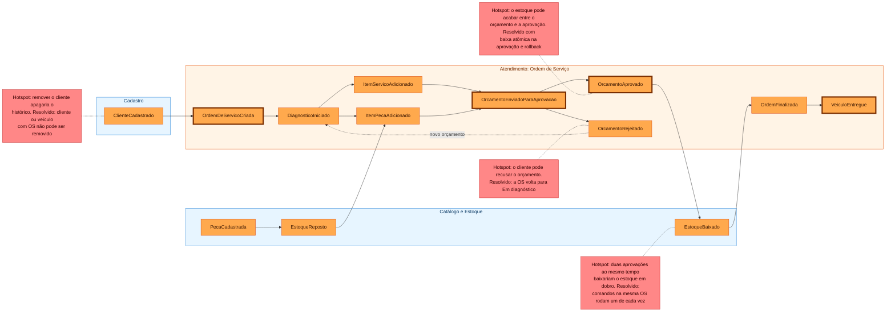
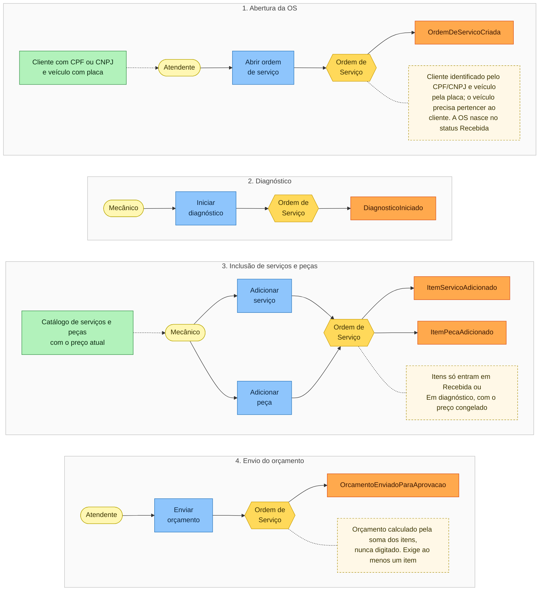
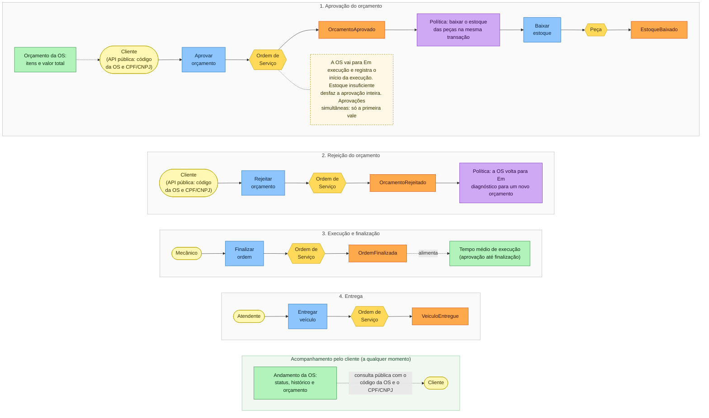
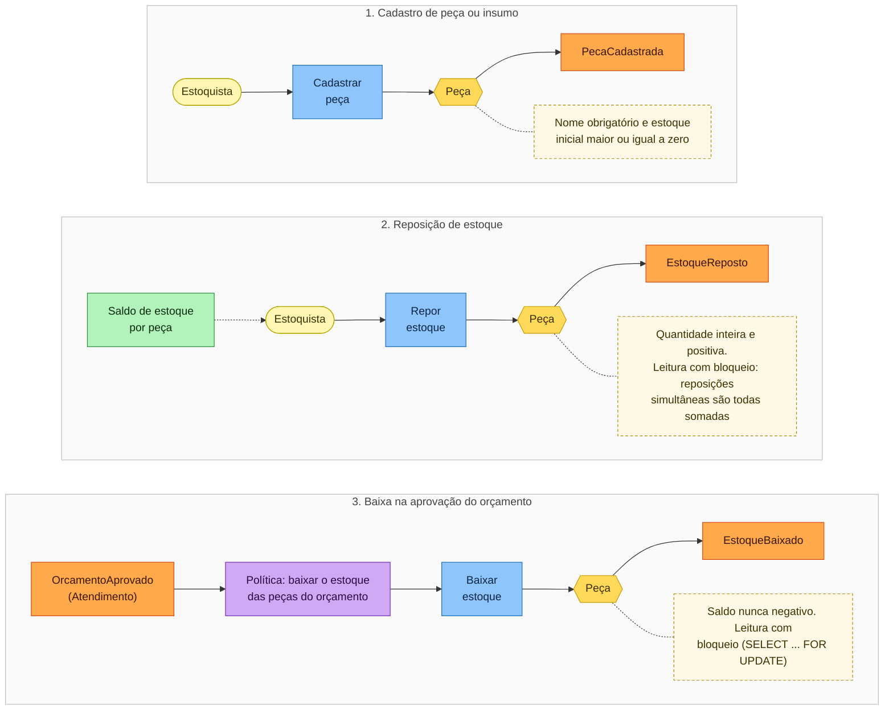

# Event Storming

Este documento registra o Event Storming da solução. Os três fluxos pedidos no desafio estão modelados: criação da Ordem de Serviço, acompanhamento da Ordem de Serviço e gestão de peças e insumos. Antes deles há a visão geral da linha do tempo (big picture) e, ao final, a consolidação dos atores, comandos, eventos, políticas, agregados, entidades e objetos de valor.

Os diagramas usam Mermaid, são renderizados diretamente no GitHub e seguem as cores convencionais dos post-its do Event Storming. A versão exportada está em [event-storming.pdf](event-storming.pdf) e as imagens individuais em [imagens/](imagens/).

## Legenda dos elementos

| Cor | Elemento | Representa |
|-----|----------|-----------|
| Laranja | Evento de domínio | Fato de negócio que já ocorreu (nomeado no passado). |
| Azul | Comando | Intenção de alterar o sistema (o que um ator pede). |
| Amarelo claro | Ator | Quem inicia o comando. |
| Amarelo | Agregado | Objeto que recebe o comando e garante as invariantes. |
| Lilás | Política | Regra reativa: quando um evento acontece, dispara outra ação. |
| Verde | Read model | Informação consultada para apoiar uma decisão. |
| Bege tracejado | Regra de negócio | Invariante verificada pelo agregado. |
| Vermelho | Hotspot | Ponto de dúvida ou risco levantado durante a modelagem. |

A gramática que liga os elementos é a mesma em todos os fluxos:

<!-- diagrama: event-storming-0-legenda -->

## Etapas aplicadas na modelagem

A modelagem seguiu as etapas usuais do Event Storming:

1. **Eventos (exploração livre)**: levantamento dos fatos relevantes do atendimento, escritos no passado, sem preocupação com ordem.
2. **Linha do tempo**: ordenação dos eventos do recebimento do veículo até a entrega, identificando os eventos pivotais que mudam a fase do atendimento.
3. **Hotspots**: registro das dúvidas e riscos (por exemplo, o estoque acabar entre o orçamento e a aprovação).
4. **Comandos e atores**: para cada evento, quem age e qual intenção o provoca.
5. **Políticas e read models**: reações automáticas a eventos e informações necessárias para cada decisão.
6. **Agregados**: agrupamento dos comandos e eventos em torno de quem garante as invariantes.
7. **Bounded contexts**: separação das linguagens e responsabilidades em contextos, que viraram os módulos do código.

## Bounded Contexts identificados

- **Atendimento (Ordem de Serviço)**: contexto central (core). Concentra o ciclo de vida da OS, o orçamento e o acompanhamento.
- **Catálogo e Estoque**: serviços oferecidos e peças com controle de estoque (contexto de suporte).
- **Cadastro**: clientes e veículos (contexto de suporte).
- **Identidade e Acesso**: autenticação dos usuários administrativos (contexto genérico).

A relação entre os contextos está no mapa de contextos em [diagramas.md](diagramas.md).

## Visão geral: linha do tempo de eventos

Linha do tempo completa, da esquerda para a direita, com os eventos agrupados por bounded context. Eventos pivotais têm borda reforçada. Os hotspots registram as dúvidas levantadas e como foram resolvidas.

<!-- diagrama: event-storming-visao-geral -->

## Fluxo 1: Criação da Ordem de Serviço

<!-- diagrama: event-storming-1-criacao -->

**Atores**: Atendente, Mecânico.
**Comandos**: Criar Ordem de Serviço, Iniciar Diagnóstico, Adicionar Serviço, Adicionar Peça, Enviar Orçamento.
**Eventos**: OrdemDeServicoCriada, DiagnosticoIniciado, ItemServicoAdicionado, ItemPecaAdicionado, OrcamentoEnviadoParaAprovacao.
**Read models**: cadastro do cliente e do veículo; catálogo de serviços e peças com o preço atual.
**Políticas / regras**:
- A OS é aberta informando o CPF/CNPJ do cliente e a placa do veículo. Os dois precisam estar cadastrados e o veículo precisa pertencer ao cliente.
- Itens só podem ser incluídos enquanto a OS está em Recebida ou Em diagnóstico.
- O preço do item é copiado do catálogo no momento da inclusão.
- O orçamento é calculado automaticamente pela soma dos itens. Não é digitado.
- O envio do orçamento exige ao menos um item.

## Fluxo 2: Acompanhamento da Ordem de Serviço

O cliente acompanha o andamento e decide sobre o orçamento pela API pública, informando o código da OS e o seu documento. Quando o cliente decide por telefone ou presencialmente, a equipe registra a mesma decisão na API administrativa.

<!-- diagrama: event-storming-2-acompanhamento -->

**Atores**: Cliente, Mecânico, Atendente.
**Comandos**: Aprovar Orçamento, Rejeitar Orçamento, Baixar Estoque (disparado pela política), Finalizar Ordem, Entregar Veículo.
**Eventos**: OrcamentoAprovado, OrcamentoRejeitado, OrdemFinalizada, VeiculoEntregue.
**Read models**: orçamento da OS; andamento da OS (consulta pública); tempo médio de execução.
**Políticas / regras**:
- A aprovação do orçamento dispara a baixa de estoque das peças, na mesma transação. Estoque insuficiente desfaz a aprovação.
- A aprovação leva a OS para Em execução e registra o início da execução.
- Comandos simultâneos na mesma OS são executados um de cada vez: se a mesma aprovação chegar duas vezes, só a primeira vale.
- A rejeição volta a OS para Em diagnóstico, permitindo um novo orçamento.
- As transições de status seguem a máquina de estados. Transições inválidas são recusadas.
- O cliente consulta o andamento informando o código da OS e o seu documento.

## Fluxo 3: Gestão de peças e insumos

<!-- diagrama: event-storming-3-gestao-pecas -->

**Atores**: Estoquista, e o processo de aprovação da OS (como gatilho da política).
**Comandos**: Criar Peça, Repor Estoque, Baixar Estoque.
**Eventos**: PecaCadastrada, EstoqueReposto, EstoqueBaixado.
**Read models**: saldo de estoque por peça.
**Políticas / regras**:
- O saldo de estoque nunca pode ficar negativo. A baixa só ocorre se houver saldo suficiente.
- A baixa de estoque é acionada pela aprovação do orçamento e participa da transação da OS.
- Baixas e reposições simultâneas da mesma peça são executadas uma de cada vez, e nenhuma se perde.

> Observação de implementação: os eventos de domínio são registrados pela raiz do agregado (`RaizDeAgregado.registrarEvento`) e documentam os fatos do modelo, mas não são publicados para outros contextos no MVP. As políticas são executadas de forma síncrona pelos casos de uso: por exemplo, `AprovarOrcamentoUseCase` chama a porta `GestaoDeEstoque` dentro da mesma transação. Os eventos do contexto de peças (PecaCadastrada, EstoqueReposto, EstoqueBaixado) representam o modelo do Event Storming. No código, a invariante de estoque é garantida pelos métodos `baixarEstoque` e `reporEstoque` do agregado `Peca`. Os eventos de domínio foram materializados como classes no agregado `OrdemDeServico`, que é o núcleo da solução, e no agregado `Cliente` (`ClienteCadastrado`).

## Consolidação

### Atores
Atendente, Mecânico, Estoquista, Cliente, Usuário administrativo.

### Comandos
Criar Ordem de Serviço, Iniciar Diagnóstico, Adicionar Serviço, Adicionar Peça, Enviar Orçamento, Aprovar Orçamento, Rejeitar Orçamento, Finalizar Ordem, Entregar Veículo, Consultar Andamento, Criar Peça, Repor Estoque, Baixar Estoque, além dos comandos de CRUD de clientes, veículos e serviços.

### Eventos de domínio
ClienteCadastrado, OrdemDeServicoCriada, DiagnosticoIniciado, ItemServicoAdicionado, ItemPecaAdicionado, OrcamentoEnviadoParaAprovacao, OrcamentoAprovado, OrcamentoRejeitado, OrdemFinalizada, VeiculoEntregue, PecaCadastrada, EstoqueReposto, EstoqueBaixado.

### Políticas e regras de negócio
- Orçamento gerado automaticamente pela soma dos itens.
- Execução só começa após aprovação do orçamento.
- Baixa de estoque atômica na aprovação, com saldo nunca negativo.
- Máquina de estados que recusa transições inválidas.
- Identificação do cliente por CPF ou CNPJ válido e do veículo por placa válida, inclusive na abertura da OS.
- Decisão do cliente pela API pública só com o código da OS e o documento dele.
- Comandos simultâneos na mesma OS ou na mesma peça executados um de cada vez.
- Cliente ou veículo com histórico de atendimento não pode ser removido.

### Read models
Cadastro do cliente e do veículo, catálogo de serviços e peças, orçamento da OS, andamento da OS (consulta pública), saldo de estoque e tempo médio de execução.

### Agregados
Ordem de Serviço (raiz), Cliente, Veículo, Serviço, Peça, Usuário.

### Entidades
Ordem de Serviço, Item de Serviço, Item de Peça, Cliente, Veículo, Serviço, Peça, Usuário.

### Objetos de valor
Documento (CPF ou CNPJ), Placa, Dinheiro, Orçamento, Aprovação, Status da Ordem de Serviço.

A correspondência entre esses elementos e os arquivos do código está em [ddd-para-codigo.md](ddd-para-codigo.md).
