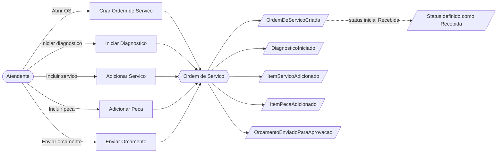
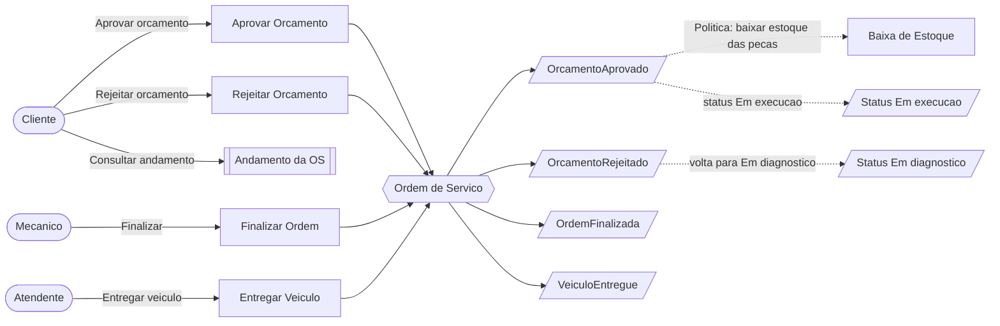
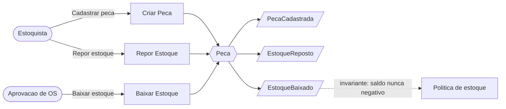

# Event Storming

Este documento registra o Event Storming da solução. Os três fluxos pedidos no desafio estão modelados: criação da Ordem de Serviço, acompanhamento da Ordem de Serviço e gestão de peças e insumos. Ao final há a consolidação dos atores, comandos, eventos, políticas, agregados, entidades e objetos de valor.

Os diagramas usam Mermaid e são renderizados diretamente no GitHub. A versão exportada está em [event-storming.pdf](event-storming.pdf) e as imagens individuais em [imagens/](imagens/).

## Legenda dos elementos

| Elemento | Representa |
|----------|-----------|
| Comando | Intenção de alterar o sistema (o que um ator pede). |
| Evento de domínio | Fato de negócio que já ocorreu (nomeado no passado). |
| Agregado | Objeto que recebe o comando e garante as invariantes. |
| Política | Regra que reage a um evento e dispara outra ação ou restrição. |
| Ator | Quem inicia o comando. |
| Read model | Dado consultado para apoiar uma decisão. |

## Bounded Contexts identificados

- **Atendimento (Ordem de Serviço)**: contexto central (core). Concentra o ciclo de vida da OS, o orçamento e o acompanhamento.
- **Catálogo e Estoque**: serviços oferecidos e peças com controle de estoque (contexto de suporte).
- **Cadastro**: clientes e veículos (contexto de suporte).
- **Identidade e Acesso**: autenticação dos usuários administrativos (contexto genérico).

A relação entre os contextos está no mapa de contextos em [diagramas.md](diagramas.md).

## Fluxo 1: Criação da Ordem de Serviço

**Atores**: Atendente, Mecânico.
**Comandos**: Criar Ordem de Serviço, Iniciar Diagnóstico, Adicionar Serviço, Adicionar Peça, Enviar Orçamento.
**Eventos**: OrdemDeServicoCriada, DiagnosticoIniciado, ItemServicoAdicionado, ItemPecaAdicionado, OrcamentoEnviadoParaAprovacao.
**Políticas / regras**:
- O cliente e o veículo precisam existir, e o veículo precisa pertencer ao cliente, para abrir a OS.
- Itens só podem ser incluídos enquanto a OS está em Recebida ou Em diagnóstico.
- O orçamento é calculado automaticamente pela soma dos itens. Não é digitado.
- O envio do orçamento exige ao menos um item.

## Fluxo 2: Acompanhamento da Ordem de Serviço

**Atores**: Cliente, Mecânico, Atendente.
**Comandos**: Aprovar Orçamento, Rejeitar Orçamento, Finalizar Ordem, Entregar Veículo, Consultar Andamento.
**Eventos**: OrcamentoAprovado, OrcamentoRejeitado, OrdemFinalizada, VeiculoEntregue.
**Políticas / regras**:
- A aprovação do orçamento dispara a baixa de estoque das peças, na mesma transação. Estoque insuficiente desfaz a aprovação.
- A aprovação leva a OS para Em execução e registra o início da execução.
- A rejeição volta a OS para Em diagnóstico, permitindo um novo orçamento.
- As transições de status seguem a máquina de estados. Transições inválidas são recusadas.
- O cliente consulta o andamento informando o código da OS e o seu documento.

## Fluxo 3: Gestão de peças e insumos

**Atores**: Estoquista, e o processo de aprovação da OS (como ator de sistema).
**Comandos**: Criar Peça, Repor Estoque, Baixar Estoque.
**Eventos**: PecaCadastrada, EstoqueReposto, EstoqueBaixado.
**Políticas / regras**:
- O saldo de estoque nunca pode ficar negativo. A baixa só ocorre se houver saldo suficiente.
- A baixa de estoque é acionada pela aprovação do orçamento e participa da transação da OS.

> Observação de implementação: os eventos do contexto de peças (PecaCadastrada, EstoqueReposto, EstoqueBaixado) representam o modelo do Event Storming. No código, a invariante de estoque é garantida pelos métodos `baixarEstoque` e `reporEstoque` do agregado `Peca`. Os eventos de domínio foram materializados como classes principalmente no agregado `OrdemDeServico`, que é o núcleo da solução.

## Consolidação

### Atores
Atendente, Mecânico, Estoquista, Cliente, Usuário administrativo.

### Comandos
Criar Ordem de Serviço, Iniciar Diagnóstico, Adicionar Serviço, Adicionar Peça, Enviar Orçamento, Aprovar Orçamento, Rejeitar Orçamento, Finalizar Ordem, Entregar Veículo, Consultar Andamento, Criar Peça, Repor Estoque, Baixar Estoque, além dos comandos de CRUD de clientes, veículos e serviços.

### Eventos de domínio
OrdemDeServicoCriada, DiagnosticoIniciado, ItemServicoAdicionado, ItemPecaAdicionado, OrcamentoEnviadoParaAprovacao, OrcamentoAprovado, OrcamentoRejeitado, OrdemFinalizada, VeiculoEntregue, PecaCadastrada, EstoqueReposto, EstoqueBaixado.

### Políticas e regras de negócio
- Orçamento gerado automaticamente pela soma dos itens.
- Execução só começa após aprovação do orçamento.
- Baixa de estoque atômica na aprovação, com saldo nunca negativo.
- Máquina de estados que recusa transições inválidas.
- Identificação do cliente por CPF ou CNPJ válido e do veículo por placa válida.

### Agregados
Ordem de Serviço (raiz), Cliente, Veículo, Serviço, Peça, Usuário.

### Entidades
Ordem de Serviço, Item de Serviço, Item de Peça, Cliente, Veículo, Serviço, Peça, Usuário.

### Objetos de valor
Documento (CPF ou CNPJ), Placa, Dinheiro, Orçamento, Aprovação, Status da Ordem de Serviço.

A correspondência entre esses elementos e os arquivos do código está em [ddd-para-codigo.md](ddd-para-codigo.md).
